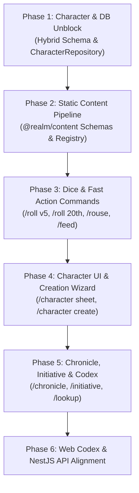

# Realm of Darkness: Comprehensive Overhaul & Architecture Plan

**Document Version:** 2.0.0  
**Date:** October 2026  
**Status:** Proposal & Technical Blueprint  
**Target:** Monorepo Overhaul (`@realm/*`, `apps/discord`, `apps/api`, `apps/codex`)

---

## 1. Executive Summary & Codebase Audit

### 1.1 Where the Project Stands Today

After examining the monorepo, its packages, and legacy roots, here is the current status:

- **Strengths & Ready Foundations:**
  - **Monorepo Tooling:** Clean Turborepo + pnpm setup. Builds succeed cleanly (`tsc -b`, turbo pipeline).
  - **Core Primitives & Errors:** `@realm/common` has robust error handling (`RealmError`, `UserError`), Snowflake utilities, and primitive schemas.
  - **Logging:** `@realm/logger` is fully functional with Winston and Discord webhook integration.
  - **Dice Mechanics:** `@realm/core` has working dice engines for V5, W5, H5, WoD 20th, and CofD.
  - **Database Infrastructure:** `@realm/database` and `@realm/repositories` have working tables and repositories for Users, Chronicles, Chronicle Members, Discord Guilds, Initiative, and Supporters.
  - **Discord Framework:** `apps/discord` features a custom Interaction Router, Discord Components V2 view patterns, actor middleware, and command/event auto-loaders.

- **Critical Bottlenecks & Gaps Identified:**
  1. **Character Database Deadlock:** `CharacterRepository` is completely stubbed out with `Promise.reject("Not implemented - schema refactoring in progress")`. The previous attempt to transition from JSONB to relational class-table inheritance (`vampire-5th.ts`) stalled when faced with the prospect of building and maintaining **23 separate relational database tables**.
  2. **Empty Static Content System:** While `packages/content/collections/` contains rich MDX source files for disciplines, banes, and powers, `packages/content/src` is completely empty. There are no Zod validation schemas for content, no compilation pipeline, and no runtime content query registry.
  3. **Minimal Discord Commands:** Only one command skeleton (`/character`) is currently registered. Essential bot capabilities from legacy—such as slash dice rolling, hunger/blood tracking, initiative tracking, chronicle management, and rules lookups—have not yet been implemented in the new framework.
  4. **Unconnected Layers:** Character entities in `@realm/core` define hunger, health, and willpower value objects, but lack persistent storage and Discord UI views to manipulate them.

---

## 2. Character Database Architecture: The "23 Schemas" Problem

### 2.1 The Problem with 23 Relational Schemas

In World of Darkness and Chronicles of Darkness, there are over 20 distinct game lines and editions:

- **5th Edition (5):** Vampire (V5), Werewolf (W5), Hunter (H5), Mortal/Human, Ghoul
- **20th Anniversary (8):** Vampire (V20), Werewolf (W20), Mage (M20), Changeling (C20), Wraith (Wr20), Demon (D20), Hunter, Human/Ghoul
- **Chronicles of Darkness (10+):** Vampire (VTR), Werewolf (WTF), Mage (MTAw), Promethean, Changeling (CTL), Hunter (HTV), Geist, Mummy, Demon, Beast

If implemented via **Relational Class-Table Inheritance** (e.g. `characters` -> `vampire_5th`, `werewolf_20th`, etc.):

- **Schema Explosion:** 23+ separate tables in PostgreSQL and Drizzle ORM.
- **Column Redundancy vs EAV Nightmare:** Either each table duplicates 50–90 columns for attributes, skills, trackers, virtues, and powers, or we create hundreds of normalized sub-tables (`character_attributes`, `character_skills`), requiring multi-join queries for a single sheet.
- **Migration Hell:** Adding or tweaking a trait (e.g., adding an optional stat or balancing a power) forces a SQL migration across live databases.
- **Complex Polymorphic Queries:** Querying a user's characters requires either 23 outer joins or 23 separate conditional queries.

### 2.2 The Solution: Hybrid Relational + Validated JSONB Document Storage

PostgreSQL offers industrial-grade JSONB support with GIN indexing and expression indexing. Combining this with TypeScript and Zod provides **strict relational integrity where needed** and **complete polymorphic flexibility for game sheets**.

#### Schema Architecture:

```text
Table: characters
├── id                (Snowflake, PK)                     ── Relational
├── userId            (Snowflake, FK -> users.id)         ── Relational (Indexed)
├── chronicleId       (Snowflake, FK -> chronicles.id)    ── Relational (Indexed, Nullable)
├── name              (VARCHAR(50))                       ── Relational (Indexed for autocomplete)
├── splat             (character_splats ENUM)             ── Relational (Indexed, e.g. 'vampire5th')
├── status            (character_status ENUM)             ── Relational ('Draft', 'Active', etc.)
├── avatarUrl         (VARCHAR(500), Nullable)            ── Relational
├── themeColor        (VARCHAR(10), Default '#000000')    ── Relational
├── data              (JSONB, NOT NULL)                   ── Polymorphic Game Document
├── createdAt         (TIMESTAMP, defaultNow())           ── Relational
└── lastUpdated       (TIMESTAMP, defaultNow())           ── Relational
```

#### Why This Is Superior:

1. **Single Table, Zero Joins:** Querying a character by ID, user, or chronicle is a simple single-table indexed `SELECT * FROM characters WHERE ...`.
2. **Type Safety at the Boundaries:** The `data` field is typed and validated using Zod discriminated unions in `@realm/common`:
   ```typescript
   export const CharacterDataSchema = z.discriminatedUnion("splat", [
     Vampire5thDataSchema,
     Werewolf5thDataSchema,
     Vampire20thDataSchema,
     // ... all splats
   ]);
   ```
3. **Domain Hydration via Factory:** In `@realm/core`, `CharacterFactory.create(row)` instantly turns the database record into a rich domain entity (`Vampire5th`, `Werewolf20th`) with its respective business methods (`increaseHunger()`, `takeDamage()`, etc.).
4. **Future-Proof Extensibility:** Adding a new splat (e.g., _Mage: The Ascension 20th_) requires **zero database migrations**. You simply define its Zod schema and entity class.
5. **Targeted JSONB Indexing (If Needed):** If we ever need to search by clan or generation across all characters, PostgreSQL allows generated virtual columns or GIN indexes:
   ```sql
   CREATE INDEX characters_v5_clan_idx ON characters ((data->>'clan')) WHERE splat = 'vampire5th';
   ```

---

## 3. Static Content System (`@realm/content`)

### 3.1 Content Nature & Separation

Static content represents immutable game reference material:

- **5th Edition:** Disciplines, Powers, Amalgams, Clans, Predator Types, Banes, Edges, Rites, Gifts
- **20th Edition:** Disciplines, Powers, Paths, Spheres, Traditions, Auspices, Tribes, Gifts, Merits/Flaws
- **CofD:** Disciplines, Contracts, Merits, Bloodlines

### 3.2 How Static Content Ties into Characters

- **Characters store References, not Content:** A character sheet stores lightweight references (slugs or IDs) and numerical ratings:
  ```json
  {
    "clan": "brujah",
    "predatorType": "alleycat",
    "disciplines": [
      {
        "id": "celerity",
        "rating": 2,
        "powers": ["fleetness", "rapid-reflexes"]
      }
    ]
  }
  ```
  Character sheets **never duplicate** descriptions, flavor text, rules text, or dice pools in the database.
- **Resolution via Content Registry:** When displaying a sheet or executing a power roll in Discord/API, the character domain or view queries `@realm/content`:
  ```typescript
  const powerDef = contentRegistry.getPower("v5", "rapid-reflexes");
  // Resolves: name, description, cost (rouse checks), duration, dicePools
  ```
- **Autocomplete Engine:** Discord slash command options (e.g. `/lookup power [name]` or `/character add-power [name]`) query `@realm/content` indices in memory for sub-millisecond responses.

### 3.3 Architecture of `@realm/content`

1. **Source of Truth:** MDX files in `packages/content/collections/{system}/{edition}/{category}/*.mdx` with standardized frontmatter:
   ```yaml
   ---
   id: fleetness
   name: Fleetness
   discipline: celerity
   level: 1
   cost: 1 Rouse check
   duration: One turn
   summary: Move with uncanny burst speed.
   ---
   Full description and mechanical rules in MDX body...
   ```
2. **Build-Time Compilation (`pnpm build:content`):**
   - Uses a fast TypeScript compiler/indexer script.
   - Validates all MDX files against Zod schemas (`DisciplineContentSchema`, `PowerContentSchema`, `ClanContentSchema`, `MeritContentSchema`).
   - Generates lean, pre-indexed JSON artifacts and TypeScript typed dictionaries in `dist/`.
3. **Runtime API (`@realm/content` public exports):**
   - `ContentRegistry`: Singleton/service providing lookup functions:
     - `getDiscipline(edition, id)`
     - `getPower(edition, id)`
     - `getClan(edition, id)`
     - `search(edition, category, query)`
   - Shared directly with `apps/discord`, `apps/api`, and `packages/core`.
4. **Docs Integration (`apps/codex`):**
   - Astro/Starlight continues reading the same collection directories directly for the public web codex wiki.

---

## 4. Discord Bot Command System (`apps/discord`)

### 4.1 Command Structure & Philosophy

- **View-First & Components V2:** Using Discord.js v14+ Components V2 (`Container`, `Section`, `TextDisplayBuilder`, buttons, string/entity selects) for clean, interactive UIs.
- **Context-Aware Interactions:** Players have an _Active Character_ in a guild/channel. Actions default to that character unless specified otherwise.
- **Ephemeral Modals & Confirmations:** Sheet editing and point expenditures use modals or interactive select menus with ephemeral confirmations.

### 4.2 Categorized Discord Command Suite

#### A. Dice Rolling System (`/roll`)

- `/roll v5 [pool] [hunger] [difficulty]`
  - Performs V5 roll with hunger dice, calculates successes, crits, messy crits, bestial failures.
  - Interactive reroll button (spend Willpower for regular dice reroll).
- `/roll 20th [pool] [difficulty] [specialty: boolean]`
  - V20 dice roll with rule-of-one botches and specialty 10s rerolls.
- `/roll w5 [pool] [rage] [difficulty]`
  - Werewolf 5th roll with Rage dice, calculates Brutal outcomes.
- `/roll cod [pool] [again: 8|9|10] [rote: boolean]`
  - Chronicles of Darkness d10 roll with exploding dice.
- `/roll simple [formula]`
  - Generic NdX dice roller (e.g. `4d10`, `1d20+4`).
- `/roll action [attribute] [skill] [difficulty]`
  - Pulls values automatically from the user's **Active Character** sheet!

#### B. Quick Tracker Actions (Fast RPG Shortcuts)

Direct slash commands or sheet button triggers for game-session speed:

- `/rouse` (or `/hunger`) - Performs a Rouse check; on failure, automatically increases hunger on the active character.
- `/feed [amount]` - Decreases hunger/restores blood pool.
- `/damage [type: superficial|aggravated] [amount]` - Applies damage to health/willpower tracker according to game rules.
- `/heal [type] [amount]` - Heals tracker boxes according to game rules.
- `/frenzy [difficulty]` - Rolls willpower/humanity against frenzy.
- `/remorse` - Performs end-of-session remorse check.

#### C. Character Management (`/character`)

- `/character create`
  - Multi-step interactive wizard:
    1. Select Edition (V5, W5, V20, W20, etc.)
    2. Select Splat & Concept
    3. Select Clan/Tribe/Tradition
    4. Allocate Attributes & Skills (via modals/selects)
    5. Save as `Draft` or `Active`
- `/character sheet [name]`
  - Displays rich character sheet container with current stats, trackers, and interactive control buttons (Rouse, Take Damage, Heal, Spend Willpower).
- `/character list`
  - Displays all user characters with statuses and splat indicators.
- `/character active [name]`
  - Sets the active character for this server/channel.
- `/character edit [name]`
  - Modal/select driven trait editor.
- `/character delete [name]`
  - Safe confirmation prompt to archive or delete.

#### D. Rules & Codex Lookup (`/lookup` or `/codex`)

- `/lookup discipline [edition] [name]`
- `/lookup power [edition] [name]`
- `/lookup clan [edition] [name]`
- `/lookup merit [edition] [name]`
- Features auto-completion powered by `@realm/content` and renders rich embeds detailing requirements, costs, and systems.

#### E. Chronicle & Guild Management (`/chronicle`)

- `/chronicle create [name]`
- `/chronicle select [name]`
- `/chronicle roster` - Lists all characters and active players in the chronicle.
- `/chronicle invite [user]` / `/chronicle kick [user]`
- `/chronicle settings` - Configure chronicle rules, difficulty thresholds, and storyteller roles.

#### F. Initiative & Combat Tracker (`/initiative`)

- `/initiative start` - Initializes combat round in the channel.
- `/initiative join [character] [modifier/roll]` - Adds combatant.
- `/initiative next` - Advances turn order; alerts current actor.
- `/initiative end` - Clears combat tracking.

---

## 5. Monorepo Package Topology & Clean Boundaries

```text
               ┌───────────────────────┐
               │    @realm/common      │  (Zero business logic: types, enums,
               └───────────┬───────────┘   zod schemas, errors, utilities)
                           │
             ┌─────────────┴─────────────┐
             ▼                           ▼
  ┌───────────────────────┐   ┌───────────────────────┐
  │    @realm/content     │   │   @realm/database     │  (Drizzle schemas,
  │  (Static game rules,  │   │  DB connection,       │   migrations)
  │   MDX parser & index) │   │  single characters tbl)
  └──────────┬────────────┘   └──────────┬────────────┘
             │                           │
             │                           ▼
             │                ┌───────────────────────┐
             │                │  @realm/repositories  │  (Exclusive DB gateway,
             │                └──────────┬────────────┘   hydrates DTOs)
             │                           │
             └─────────────┬─────────────┘
                           ▼
              ┌─────────────────────────┐
              │      @realm/core        │  (Domain entities, factories, value objects,
              └────────────┬────────────┘   dice services, actions)
                           │
         ┌─────────────────┼─────────────────┐
         ▼                 ▼                 ▼
  ┌──────────────┐  ┌──────────────┐  ┌──────────────┐
  │ apps/discord │  │   apps/api   │  │  apps/codex  │
  │ (Bot client, │  │   (NestJS    │  │   (Astro/    │
  │  views &     │  │   Fastify    │  │  Starlight   │
  │  handlers)   │  │   REST/WS)   │  │    wiki)     │
  └──────────────┘  └──────────────┘  └──────────────┘
```

### Dependency Rules:

1. **Zero Database Access Outside Repositories:** No app or core service touches `@realm/database` directly. All queries pass through `@realm/repositories`.
2. **Domain Encapsulation:** `@realm/core` never imports Discord.js or NestJS.
3. **No Circular Imports:** Handlers import Views; Views never import Handlers. Views export interaction IDs and payload schemas.

---

## 6. Phased Implementation Roadmap



### Phase 1: Unblock Characters & Database Persistence (Immediate Priority)

1. **Clean Database Schema:**
   - Delete experimental `vampire-5th.ts` table.
   - Update `characters.ts` in `@realm/database`: add `data: jsonb().notNull()`, `avatarUrl`, and `themeColor`.
   - Run migration / schema generation (`pnpm db:generate`).
2. **Implement `CharacterRepository`:**
   - Implement `findById`, `findByUser`, `findByChronicle`, `create`, `update`, `delete`, and `exists`.
   - Validate JSONB data with `CharacterDataSchema` at the boundary.
3. **Connect Factory in `@realm/core`:**
   - Ensure `CharacterFactory` hydrates entities cleanly from repository DTOs.
   - Add unit tests verifying character persistence roundtrips.

### Phase 2: Static Content Pipeline (`@realm/content`)

1. **Define Content Zod Schemas:**
   - In `packages/content/src/schemas/`: `discipline.schema.ts`, `power.schema.ts`, `clan.schema.ts`, `merit.schema.ts`.
2. **Build Indexer / Loader Script:**
   - Write an automated indexer in `packages/content` that parses MDX frontmatter and compiles a typed registry cache.
3. **Export `ContentRegistry`:**
   - Provide synchronous in-memory search and get methods for apps and core.

### Phase 3: Discord Dice & Fast RPG Commands

1. **Slash Dice Commands:**
   - Implement `/roll v5`, `/roll 20th`, `/roll w5`, `/roll cod`, `/roll simple`.
   - Create interactive dice result views with Discord Components V2.
2. **Fast Tracker Commands:**
   - Implement `/rouse`, `/feed`, `/damage`, `/heal` tied to active characters.

### Phase 4: Full Character Views & Creation Wizard

1. **Character Sheet View (`sheet.views.ts` & `sheet.handlers.ts`):**
   - Rich interactive character sheet with action buttons.
2. **Character Creation Wizard:**
   - Step-by-step creation flow for V5 & V20 characters.
3. **Active Character Management:**
   - Guild/channel scoped active character switching (`/character active`).

### Phase 5: Chronicle, Initiative & Codex Commands

1. **Initiative Tracker:**
   - Interactive initiative manager in Discord channels using `initiativeTrackers` table.
2. **Codex Lookup Command:**
   - `/lookup` command with Discord autocomplete backed by `ContentRegistry`.
3. **Chronicle Features:**
   - Finalize chronicle roster, settings, and permissions.

### Phase 6: NestJS API & Astro Codex Alignment

1. **API Endpoints:**
   - Expose character endpoints in `apps/api` using `CharacterRepository`.
2. **Starlight Docs:**
   - Connect `apps/codex` content loaders to the validated MDX collections.

---

## 7. Immediate Next Steps / Action Items

To resume active development seamlessly:

1. [ ] **Approve the Database Architecture:** Formally adopt the Hybrid Relational + Validated JSONB model to eliminate the 23-schema roadblock.
2. [ ] **Implement Phase 1:**
   - Update `@realm/database` character table.
   - Implement `@realm/repositories/src/character.repository.ts`.
   - Verify with tests.
3. [ ] **Scaffold Phase 2 (`@realm/content`):**
   - Add content Zod schemas and registry export.
4. [ ] **Expand Discord Slash Commands:**
   - Build the dice command handlers using existing dice services in `@realm/core`.
