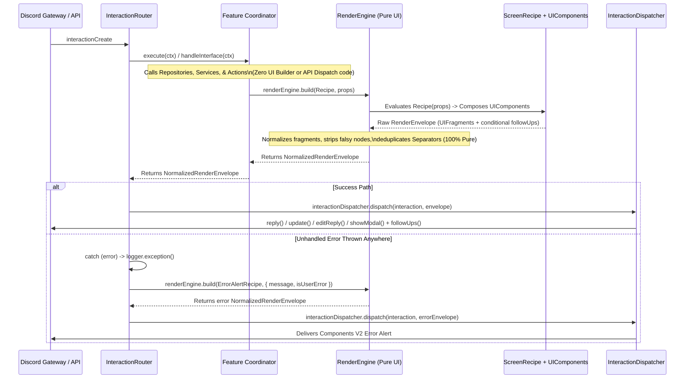

# Discord Application Architecture & Interaction Pipeline

This document defines the canonical architecture for commands, component interactions, stateless session persistence, error handling, the pure Composable Render Engine, and the Interaction Dispatcher in `@realm/discord`.

---

## 1. Core Architectural Pillars

1. **MDX Documentation as Single Source of Truth (SSOT)**:
   - Every slash command is defined inside the YAML frontmatter of its documentation file in `packages/content/collections/documentation/discord/commands/{command}.mdx`.
   - To add or modify a command or its options, you **must** update its MDX file.
   - The MDX frontmatter is validated by `CommandDocFrontmatterDataSchema` (`@realm/common`) and converted directly into a `SlashCommandBuilder` via `buildSlashCommandFromMdx()`.
   - Game mechanics (`collections/mechanics/`) and app documentation (`collections/documentation/discord/`, `collections/documentation/website/`) are strictly separated.

2. **Stateless in Memory, Session State in PostgreSQL**:
   - **Never** use Discord.js in-memory collectors (`createMessageComponentCollector`).
   - All multi-step workflows (creation wizards, sheet editors, interactive dice builders) persist state in the PostgreSQL `interaction_sessions` table via `InteractionSessionRepository` (`@realm/repositories`).
   - Every interactive button, select menu, and modal uses a single uniform `customId` format:
     ```text
     {handlerId}:{sessionId}:{control}
     ```
   - Domain payloads (character names, stats, splats, page numbers) are **never** encoded into `customId`; they live exclusively inside the validated `interaction_sessions.state` JSONB column.

3. **Coordinator $\rightarrow$ Render Engine (Pure UI) $\rightarrow$ InteractionRouter $\rightarrow$ InteractionDispatcher**:
   - **Coordinators** (`*.coordinator.ts`) orchestrate incoming commands and component interactions. They call **Repositories** (`@realm/repositories`), **Services** (`@realm/core`), and reusable **Actions** (`@realm/core` or `apps/discord`).
   - **Coordinators never call Discord reply/edit/followUp methods directly.** Instead, a Coordinator returns `renderEngine.build(Recipe, props)`—which produces a pure, normalized data structure (`NormalizedRenderEnvelope`)—back to `InteractionRouter`.
   - **Render Engine (`RenderEngine`) is 100% Pure UI Assembly**: It takes a `ScreenRecipe<TProps>` and `props`, evaluates the React-like `UIComponent` tree, flattens nested `UIFragment`s, strips falsy conditionals (`null`, `undefined`, `false`), deduplicates adjacent `SeparatorBuilder`s, and returns a `NormalizedRenderEnvelope`. It has **zero** Discord API or network side effects.
   - **Interaction Dispatcher (`InteractionDispatcher`) is the Single Discord API Delivery Layer**: Called exclusively by `InteractionRouter` to deliver a `NormalizedRenderEnvelope` (primary reply/update/modal + `0..N` conditional `followUp` messages) to Discord.

4. **Centralized Bubble-Up Error Handling**:
   - Do **not** wrap coordinator, action, or service methods in defensive `try/catch` blocks.
   - Throw `UserError` for user-facing validation or precondition errors, and `RealmError` for internal invariant failures. Let third-party errors bubble up naturally.
   - Because Coordinators return a pure `NormalizedRenderEnvelope` instead of sending messages mid-execution, if an error occurs anywhere in the pipeline, **nothing has been sent to Discord yet**.
   - `InteractionRouter` catches all unhandled exceptions at the top boundary, passes them to `logger.exception()`, builds `renderEngine.build(ErrorAlertRecipe, ...)`, and hands that error envelope to `interactionDispatcher.dispatch(interaction, errorEnvelope)`.

---

## 2. End-to-End Pipeline Diagram



---

## 3. Separation of Responsibilities in the UI & Delivery Layer

| Layer                       | Location                                                     | Responsibility                                                                                                                                                                                           | Side Effects?        |
| :-------------------------- | :----------------------------------------------------------- | :------------------------------------------------------------------------------------------------------------------------------------------------------------------------------------------------------- | :------------------- |
| **`UIComponent<TProps>`**   | `src/ui/components/**/*.component.ts`                        | Stateless React-like functional building blocks (`<TrackerBar />`, `<DiceTray />`, `<ConfirmationBar />`) returning a `UIFragment`.                                                                      | **None (Pure)**      |
| **`ScreenRecipe<TProps>`**  | Feature folder (`*.recipes.ts`) or `src/ui/recipes/`         | Composes `UIComponent`s into a `RenderEnvelope` (a primary message or modal + `0..N` conditional `followUps`).                                                                                           | **None (Pure)**      |
| **`RenderEngine`**          | `src/ui/engine/render-engine.ts`                             | Evaluates a `ScreenRecipe<TProps>`, flattens nested `UIFragment`s, removes `null`/`false` conditionals, collapses duplicate separators, and returns a `NormalizedRenderEnvelope`.                        | **None (Pure)**      |
| **`InteractionDispatcher`** | `src/framework/interaction-router/interaction-dispatcher.ts` | Inspects the live Discord `Interaction` state (`deferred`, `replied`, `isMessageComponent`) and delivers the `NormalizedRenderEnvelope` via `reply`, `update`, `editReply`, `showModal`, and `followUp`. | **Discord REST API** |

---

## 4. Where Recipes vs. Components Live

To prevent a single monolithic views folder while keeping components reusable across the entire bot:

- **Shared UI Components (`src/ui/components/`)**:
  - `src/ui/components/common/`: Universal building blocks (`TextBlockComponent`, `DividerComponent`, `ActionBannerComponent`, `ConfirmationBarComponent`, `ErrorAlertComponent`).
  - `src/ui/components/character/`: Reusable character sheet widgets (`CharacterIdentityComponent`, `CharacterTrackersComponent`, `TrackerQuickButtonsComponent`) that can be rendered inside `/character` **and** inside `/roll` ephemeral follow-ups!
  - `src/ui/components/dice/`: Reusable dice trays, Rouse Check badges, and Willpower reroll rows.
- **Screen Recipes (`*.recipes.ts`)**:
  - **System-Wide Recipes** live in `src/ui/recipes/` (e.g., `ErrorAlertRecipe`).
  - **Edition-Shared Recipes** live in the edition folder (e.g., `src/features/character/shared-5th/character-5th.recipes.ts`).
  - **Feature / Splat Recipes** live right alongside their coordinator (e.g., `src/features/character/character.recipes.ts` or `src/features/character/v5/v5-character.recipes.ts`).

---

## 5. Rules & Best Practices Checklist

- [ ] **Never use `MessageComponentCollector`**: Always persist state via `InteractionSessionRepository` and encode `customId` with `encodeSessionCustomId(handlerId, sessionId, control)`.
- [ ] **Never hardcode command definitions in TypeScript**: Always define or update the command in `packages/content/collections/documentation/discord/commands/{name}.mdx` and load it via `buildSlashCommandFromMdx(name)`.
- [ ] **Coordinators return `NormalizedRenderEnvelope`**: Coordinators must return `renderEngine.build(Recipe, props)` and let `InteractionRouter` + `InteractionDispatcher` handle sending the response to Discord.
- [ ] **Keep `RenderEngine` 100% pure**: `RenderEngine` only constructs and normalizes UI envelopes; all Discord API calls belong in `InteractionDispatcher`.
- [ ] **Let errors bubble up**: Throw `UserError` or `RealmError` directly; never write boilerplate `try/catch` blocks inside coordinators to format error replies manually.
