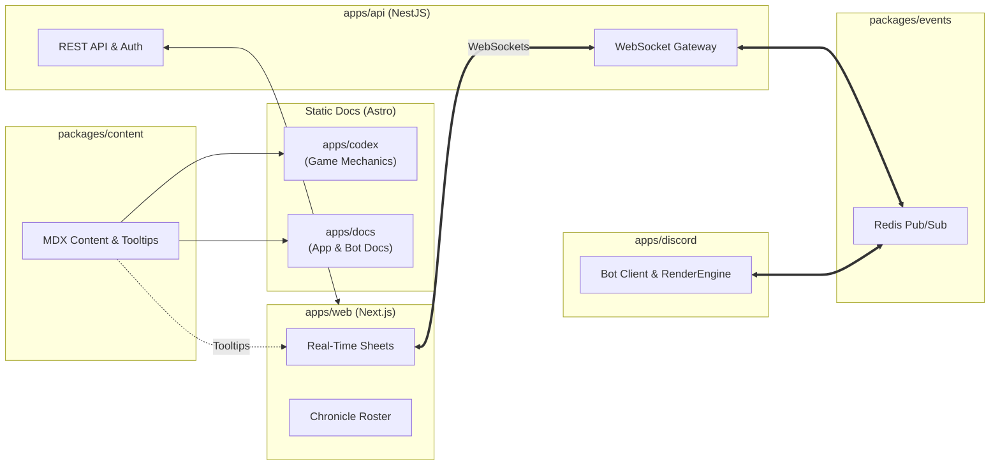

# Realm of Darkness: Refactor & Overhaul Task Directory

This directory contains high-level architecture overviews, task definitions, and implementation plans across the Realm of Darkness monorepo.

> [!NOTE]
> Documents in this directory serve as high-level overviews to align cross-package architecture and requirements. Granular tickets and exact implementation steps will be refined as each respective overhaul phase begins.

---

## Architecture Overviews by Domain

| Domain                       | Document                                                                                              | Summary                                                                                                                                                                |
| ---------------------------- | ----------------------------------------------------------------------------------------------------- | ---------------------------------------------------------------------------------------------------------------------------------------------------------------------- |
| **Documentation & Codex**    | [`refactor/codex/documentation-sites-overview.md`](./codex/documentation-sites-overview.md)           | Dual-site static documentation architecture (`apps/codex` for Game Mechanics, `apps/docs` for Bot & App Docs) and programmatic tooltip query APIs in `@realm/content`. |
| **Web Frontend Platform**    | [`refactor/web/web-frontend-overview.md`](./web/web-frontend-overview.md)                             | Next.js (React 19, Tailwind) web platform with zero-polling real-time character sheets, chronicle management, and supporter portal.                                    |
| **API & Real-Time Gateway**  | [`refactor/api/realtime-gateway-overview.md`](./api/realtime-gateway-overview.md)                     | NestJS Fastify WebSocket gateway, Discord OAuth2 with HTTP-only cookies, and Redis Pub/Sub bridge connecting web clients and Discord shards.                           |
| **Discord Bot Architecture** | [`refactor/discord/character-stateless-scalability.md`](./discord/character-stateless-scalability.md) | Composable UI `RenderEngine`, stateless interaction coordinator pipeline, and multi-action workflows.                                                                  |

---

## Cross-Domain Event & Data Flow

