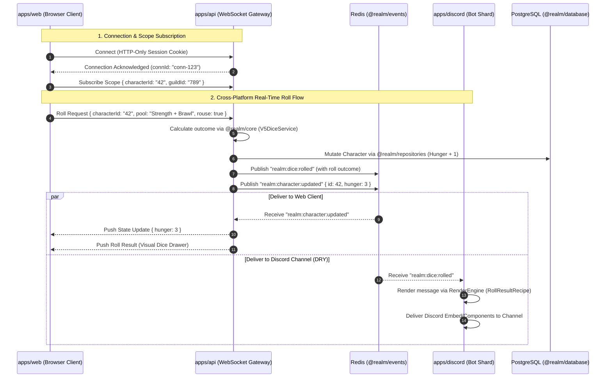

# API & Real-Time Gateway: WebSockets, Redis Pub/Sub, and Event Routing

> [!NOTE]
> This document is a high-level architectural overview. Specific protocol opcodes, socket connection maps, authentication guard specifications, and controller routes will be refined once we dig deeper into this portion of the overhaul.

---

## 1. Executive Summary

`apps/api` serves as the central backend API and real-time distribution gateway for the Realm of Darkness ecosystem. It provides:

- **Fastify WebSocket Gateway**: A high-performance real-time connection hub for web clients, completely eliminating client-side polling.
- **Redis Pub/Sub Event Bridge**: Real-time integration with `@realm/events`, subscribing to domain events (`character:updated`, `guild:updated`, `dice:rolled`, `gateway:broadcast`) and forwarding them to subscribed browser connections.
- **Discord OAuth2 & Decoupled Authentication**: Secure authentication setting HTTP-only cookies while maintaining a clean separation between the user account and third-party login providers.
- **DRY Dice Pipeline**: Evaluates dice rolls triggered by web clients via `@realm/core`, persists any associated state mutations (e.g., Hunger changes on failed Rouse Checks), and emits events to Redis so `apps/discord` renders channel messages using its existing pure `RenderEngine`.

---

## 2. Real-Time Communication Architecture

---

## 3. Core Modules & Responsibilities

### A. Real-Time WebSocket Gateway (`apps/api/src/gateway`)

- **Technology**: Fastify WebSocket plugin (`@fastify/websocket`) embedded in NestJS.
- **Connection Management**:
  - Validates session upon connection.
  - Maintains in-memory lookup table of active sockets mapped to user IDs, character IDs, and guild/chronicle IDs.
  - Supports heartbeat / ping-pong frames to automatically prune dead connections.
- **Loopback Suppression**: Uses `publisherId` and `connectionId` metadata so that the client initiating an action does not receive redundant duplicate echo events.

### B. Redis Event Integration (`apps/api/src/events`)

- Wraps `@realm/events/EventClient` as an injectable NestJS singleton service.
- On bootstrap, binds subscriptions to:
  - `realm:character:*`
  - `realm:guild:*`
  - `realm:member:*`
  - `realm:user:*`
  - `realm:gateway:broadcast`
- Translates incoming Redis messages into targeted WebSocket frame deliveries to active client connections.

### C. Authentication & Session Management (`apps/api/src/auth`)

- **OAuth2 Provider**: Discord OAuth2 flow (`/auth/discord/login` -> `/auth/discord/callback`).
- **Session Transport**: Encrypted HTTP-only cookies (`SameSite=Lax`, `Secure` in production).
- **Decoupled User Identity**:
  - Authentication matches Discord Snowflake to a linked identity.
  - Core `users` table uses decoupled IDs, enabling future multi-provider auth (Google, email/password) without schema breaking changes.

### D. Billing & Supporter Service (`apps/api/src/billing`)

- Direct replacement for legacy Patreon webhooks.
- Integrates Stripe / LemonSqueezy checkout sessions and webhook verification.
- Updates `supporters` table in PostgreSQL and publishes `user:updated` events over Redis to instantly reflect boost allocations and badge upgrades across web and Discord.

---

## 4. Phasing & Refinement Roadmap

1. **Phase 1: Event Client Service**: Integrate `@realm/events` `EventClient` into `apps/api` with lifecycle management (connect/disconnect).
2. **Phase 2: WebSocket Gateway**: Scaffold `apps/api/src/gateway/` with connection auth, room subscriptions, and outbound message dispatching.
3. **Phase 3: Discord OAuth2 & Cookies**: Implement `/auth/discord` routes, cookie serialization, and `/auth/me` endpoint.
4. **Phase 4: Character REST & Event Mutation**: Wire `/characters/:id` routes to `@realm/repositories`, ensuring mutations emit Redis events.
5. **Phase 5: Cross-Platform Dice Pipeline**: Connect web roll endpoint to `@realm/core` dice services and publish `realm:dice:rolled` events to trigger Discord bot rendering.
6. **Phase 6: Billing Webhooks**: Implement Stripe subscription lifecycle events and boost updates.
