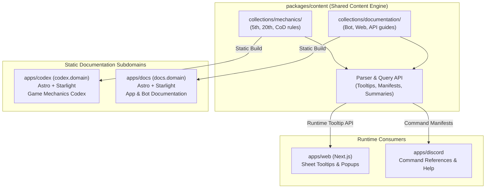

# Documentation Ecosystem: Dual-Site Architecture & Shared Content Engine

> [!NOTE]
> This document is a high-level architectural overview. Detailed component specifications, routing matrices, and MDX frontmatter schemas will be refined once we dig deeper into this portion of the overhaul.

---

## 1. Executive Summary

The Realm of Darkness documentation layer is segregated into two independent static websites sharing a single, unified content foundation:

1. **Game Mechanics Codex (`apps/codex`)**: Dedicated solely to World of Darkness and Chronicles of Darkness rules, editions, clans, disciplines, banes, gifts, and systems (`codex.realmofdarkness.com`).
2. **Application & Bot Documentation (`apps/docs`)**: Dedicated to user guides, Discord bot slash commands, dice syntax, web application manuals, and developer APIs (`docs.realmofdarkness.com`).
3. **Shared Content Engine (`packages/content`)**: The single source of truth for raw MDX content, schema validations, and programmatic query APIs used not only for building the static sites, but also for serving dynamic tooltips, popups, and quick references in `apps/web` and Discord command help.

---

## 2. High-Level Architecture

---

## 3. Site 1: Game Mechanics Codex (`apps/codex`)

- **Host Subdomain**: `codex.realmofdarkness.test` / `codex.realmofdarkness.com`
- **Engine**: Astro + `@astrojs/starlight`
- **Content Root**: `packages/content/collections/mechanics/`
- **Scope & Hierarchy**:
  - `5th/`:
    - `v5/`: Clans, Disciplines & Powers, Predator Types, Banes, Blood Potency rules.
    - `w5/`: Auspices, Tribes, Gifts & Rites, Renown, Harano/Hauglosk rules.
    - `h5/`: Creeds, Edges, Despair & Drive.
  - `20th/`:
    - `v20/`, `w20/`, `m20/`, `c20/`, `d20/`, `wr20/` rulebooks, lineages, powers, and combat systems.
  - `cod/`:
    - `vtr/`: Requiem clans, covenants, disciplines, bloodlines.
- **Search**: Fully localized, pre-indexed client search using Starlight Pagefind.
- **Aesthetic**: Deep gothic dark mode, edition badges, blood-red and lunar accents, formatted tracker previews.

---

## 4. Site 2: Application & Bot Documentation (`apps/docs`)

- **Host Subdomain**: `docs.realmofdarkness.test` / `docs.realmofdarkness.com`
- **Engine**: Astro + `@astrojs/starlight`
- **Content Root**: `packages/content/collections/documentation/`
- **Scope & Hierarchy**:
  - `getting-started/`: Adding the bot, creating first character, linking servers.
  - `discord/`: Complete slash command catalog (`/roll`, `/character`, `/chronicle`, `/initiative`, `/storyteller`), option descriptions, permission requirements.
  - `web/`: Guide to online character sheets, chronicle dashboards, and supporter boosts.
  - `dice-syntax/`: Detailed guide to advanced roll formulas, difficulties, rouse checks, rote actions, and exploding dice.
  - `developers/`: Architecture overview, WebSocket gateway protocol, contributing guides.

---

## 5. Shared Content Engine (`packages/content`)

`packages/content` is not just static markdown—it is a typed, programmatic content library:

- **Zod Schemas**: Strict frontmatter validation for clans, disciplines, banes, powers, and command documentation.
- **Query & Tooltip API**:
  - `getDisciplineTooltip(edition, disciplineId, powerId)`: Returns concise title, pool, cost, and rule snippet for web sheet hovercards.
  - `getBaneTooltip(edition, clanId)`: Returns quick rules snippet for clan weakness.
  - `getCommandDoc(commandName)`: Returns command descriptions and parameter metadata for Discord slash commands and web command explorers.

---

## 6. Phasing & Refinement Roadmap

1. **Phase 1: Content Query API (`packages/content`)**: Define lightweight parser utilities and tests for tooltip data extraction.
2. **Phase 2: Mechanics Codex Focus (`apps/codex`)**: Lock down loader and sidebar autogeneration strictly to `mechanics/`.
3. **Phase 3: Scaffold Docs Site (`apps/docs`)**: Initialize `apps/docs`, mirror Starlight gothic theme, point loader to `documentation/`.
4. **Phase 4: Deep Content Migration**: Port remaining legacy rulebook text and command documentation into modern MDX schemas.
