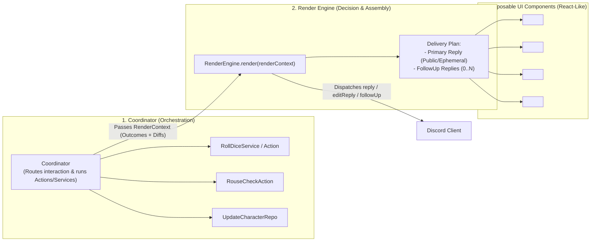

# Discord Architecture: Composable Render Engine & Multi-Action Coordinator Pipeline

## 1. The Shift: Moving Beyond Traditional 1-Message "Views"

Traditional Discord bot architectures assume a rigid `1 Command/Button -> 1 Action -> 1 View Message` pipeline. In **Realm of Darkness**, real gameplay interactions are far richer and context-dependent.

### Real-World Example: Rolling Dice Tied to a Character

When a player executes a roll (either via `/roll` or clicking a roll button on their sheet) with a Rouse Check enabled:

1. **Multiple Domain Actions & Services Execute in Sequence**:
   - **Action/Service 1**: Calculate and roll the main dice pool (e.g., `V5DiceService.roll`).
   - **Action/Service 2**: Roll the Rouse Check (e.g., `V5DiceService.rollRouseCheck`).
   - **Action/Service 3**: If the Rouse Check failed, mutate the character's Hunger (`+1 Hunger`) and persist to PostgreSQL via `CharacterRepository`.
2. **Multiple Discord Messages (or Multi-Part Responses) Are Produced**:
   - **Primary Message (Public in Channel)**: The Dice Roll Result + Rouse Check outcome + interactive `[Reroll with Willpower]` button.
   - **Conditional Follow-up Message (Ephemeral to Player)**: _Only if the character's stats actually changed_ (e.g., Hunger increased from 2 to 3, or Willpower was spent), send an ephemeral follow-up containing the **Updated Character Tracker Component** (the exact same tracker component used inside the `/character` sheet!).

If we built rigid "Views", we would have to duplicate the Character Tracker UI inside the Dice Roller, and the Coordinator would be cluttered with `interaction.editReply` vs. `interaction.followUp` UI construction logic.

---

## 2. The New Architecture: Coordinators + Render Engine + UI Components

We split the Discord layer into three distinct, decoupled responsibilities:



---

## 3. How Each Layer Works

### 3.1 Layer 1: Coordinators + Actions/Services (Pure Orchestration, Zero UI Code)

- The **Coordinator** receives the interaction and loads the PostgreSQL session.
- Because complex game operations (like rolling dice + rouse check + updating hunger + checking frenzy thresholds) naturally decompose into reusable **Actions** and **Services** (`@realm/core`), the Coordinator stays small by calling those building blocks.
- If a Coordinator ever grows too large, we split it by domain (e.g., `RollCoordinator`, `CharacterCoordinator`) while sharing the underlying Actions/Services.
- When the Coordinator finishes executing its business logic, it **does not** construct `TextDisplayBuilder`s or `ButtonBuilder`s, and it **does not** decide which components to assemble.
- Instead, it hands a strongly-typed **`RenderContext`** (containing the updated session, domain results, and a `characterChanged: boolean` flag) to the **Render Engine**.

### 3.2 Layer 2: The Render Engine (Decides _What_ and _How_ to Deliver)

Instead of returning a single raw Discord message object, the **Render Engine** evaluates the `RenderContext` and produces a **`RenderEnvelope`** (a delivery plan that can contain a primary response plus zero or more follow-up messages):

```typescript
export interface RenderMessagePayload {
  /** Discord Components V2 array */
  components: TopLevelComponentBuilder[];
  /** Whether this message is ephemeral (only visible to the user) */
  ephemeral?: boolean;
  /** How this message should be delivered on the interaction */
  delivery: "reply" | "edit" | "followUp" | "modal";
}

export interface RenderEnvelope {
  /** Primary response (editReply, reply, or showModal) */
  primary: RenderMessagePayload | ModalBuilder;
  /** Optional secondary messages (e.g., ephemeral character stat update after a public roll) */
  followUps?: RenderMessagePayload[];
}
```

Look at what the Render Engine does when given a **Roll Context**:

1. It builds the **Primary Message** (`delivery: "reply"`, `ephemeral: false`) by composing:
   - `CharacterIdentityBanner(character)`
   - `DicePoolResultBlock(rollResult)`
   - `RouseCheckBlock(rouseResult)` (if a Rouse Check occurred)
   - `RollActionRow(sessionId, { canWillpowerReroll: true })`
2. It inspects `context.characterChanged`:
   - If `true` (e.g., Hunger increased on the Rouse Check or Willpower was spent), it automatically appends a **Follow-Up Message** (`delivery: "followUp"`, `ephemeral: true`) composed of:
     - `StateChangeAlert("🩸 Hunger increased to 3/5")`
     - `CharacterTrackerBlock(character)` _(reused directly from the Character UI components!)_
     - `TrackerQuickButtonsRow(sessionId, character)` _(allowing the player to immediately interact with their updated trackers right from the ephemeral follow-up!)_

### 3.3 Layer 3: React-Like UI Components (`*.component.ts`)

Instead of monolithic "Page Views", our UI layer is a library of **stateless, composable UI Components**—just like React functional components—that return Discord Components V2 builders (`TextDisplayBuilder`, `SeparatorBuilder`, `ActionRowBuilder`):

```text
apps/discord/src/ui/
├── engine/
│   ├── render-engine.ts              # Evaluates RenderContext -> executes RenderEnvelope
│   └── render-envelope.types.ts      # Delivery contracts (primary + followUps)
│
├── components/
│   ├── common/                       # Universal building blocks
│   │   ├── header-banner.component.ts
│   │   ├── confirmation-bar.component.ts
│   │   └── navigation-footer.component.ts
│   │
│   ├── character/                    # Reusable Character UI blocks
│   │   ├── identity-card.component.ts
│   │   ├── tracker-bar.component.ts  # Used in BOTH /character AND /roll follow-ups!
│   │   ├── attribute-grid.component.ts
│   │   └── splat-widgets/            # Splat-specific UI widgets (V5 Hunger, W5 Rage, V20 Blood)
│   │
│   └── dice/                         # Reusable Dice UI blocks
│       ├── dice-tray.component.ts    # Renders custom dice emojis from @realm/assets
│       ├── rouse-result.component.ts # Used in BOTH /roll AND /character quick actions!
│       └── reroll-controls.component.ts
```

---

## 4. Why This Solves Both `/character` and `/roll` (and Future Features)

| Scenario                                                 | How the Component + Render Engine Architecture Handles It                                                                                                                                                                                                                                     |
| :------------------------------------------------------- | :-------------------------------------------------------------------------------------------------------------------------------------------------------------------------------------------------------------------------------------------------------------------------------------------- |
| **User performs a Rouse Check from `/character` Editor** | `CharacterCoordinator` runs `RouseCheckAction` $\to$ hands context to `RenderEngine` $\to$ Engine re-renders the sheet in-place (`edit`) with `<RouseResultComponent />` at the top and updated `<TrackerBarComponent />`.                                                                    |
| **User rolls dice with a Rouse Check from `/roll`**      | `RollCoordinator` runs `RollAction` + `RouseCheckAction` $\to$ hands context to `RenderEngine` $\to$ Engine sends public roll (`<DiceTrayComponent />` + `<RouseResultComponent />`) AND, because Hunger changed, automatically sends an ephemeral `followUp` with `<TrackerBarComponent />`! |
| **5 Buttons Lead to the Same Screen with Minor Tweaks**  | All 5 buttons mutate state in their Coordinator and pass the updated session to `RenderEngine`. The Engine composes the same `<AttributeGridComponent />` and swaps only the footer component based on `session.state.mode`.                                                                  |
| **1 Button Branches to 3 Screens + Side Effects**        | The Coordinator runs the required Actions/Services, updates `session.step`, and passes the result to `RenderEngine`. The Engine inspects the new `step` + any side-effect flags and dispatches both the new screen and any conditional follow-ups.                                            |

---

## 5. End-to-End Code Flow Example

Here is how clean a Coordinator method becomes when decoupled from UI construction via the Render Engine:

```typescript
// Inside V5RollCoordinator (or Action)
public async handleRollWithRouse(ctx: InterfaceContext): Promise<void> {
  const { sessionId } = decodeSessionCustomId(ctx.interaction.customId);
  const session = await this.sessionRepo.getActive(sessionId, RollSessionSchema, ctx.actor.id);

  // 1. Execute reusable domain actions/services
  const rollOutcome = this.v5DiceService.roll(session.state.pool);
  const rouseOutcome = this.v5DiceService.rollRouseCheck();

  let updatedCharacter = await this.characterRepo.findById(session.state.characterId);
  let characterChanged = false;

  if (!rouseOutcome.success && updatedCharacter.hunger < 5) {
    updatedCharacter = await this.increaseHungerAction.execute(updatedCharacter.id, 1);
    characterChanged = true;
  }

  // 2. Hand off to the Render Engine — Coordinator knows ZERO about Discord builders!
  await renderEngine.respond(ctx.interaction, {
    type: "v5_roll_completed",
    sessionId: session.id,
    roll: rollOutcome,
    rouse: rouseOutcome,
    character: updatedCharacter,
    characterChanged,
  });
}
```

And inside `renderEngine.respond(...)`:

- It maps `"v5_roll_completed"` to its recipe of **UI Components** (`<DiceTray />`, `<RouseBadge />`, and conditionally an ephemeral `followUp` with `<CharacterTrackerCard />`).
- It automatically handles `deferReply` / `editReply` / `followUp` against the Discord.js `interaction` object so Coordinators never have to manage Discord message flags or follow-up plumbing!
